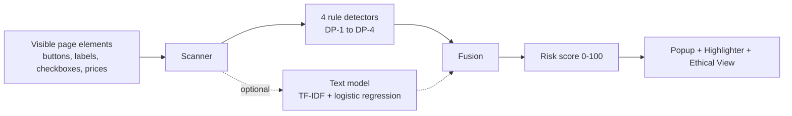

 ##DarkGuard AI

### See the trick behind the deal.

**A privacy-first Chrome and Edge extension that spots dark patterns on shopping pages, shows the proof, and lets you read the page honestly with one click.**


[](test-site/index.html)


[**Install in 2 minutes**](#install-in-2-minutes) · [**Try it yourself**](#try-it-yourself) · [**How it works**](#how-it-works) · [**Results**](#results-the-honest-numbers) · [**Roadmap**](#roadmap)

</div>

---

## The problem

You are about to buy something online.

- A timer says **"Deal ends in 14:59"**. You refresh. Still **14:59**.
- **"70% OFF!"** But the old price is **$400** and the new one is **$200**. That is 50%.
- The decline button says **"No thanks, I prefer paying full price."**
- A **$49.99 warranty** is already ticked in your cart.

These are **dark patterns**: interface tricks designed to make you decide fast, not decide well. Nothing in your browser warns you about them. Until now.

## What DarkGuard AI does

Click **Scan this page** and DarkGuard AI:

1. **Finds** four kinds of manipulation on the page.
2. **Proves** each one with evidence you can check yourself.
3. **Scores** the page from 0 to 100 so you see the risk at a glance.
4. **Points** at the exact element when you click a finding.
5. **Explains** in plain language with **Ethical View**, and restores the original page with one click.

| | |
|---|---|
| **Evidence-based findings** | A frozen timer, a failed percentage calculation, a matched guilt phrase, a ticked box. Every finding shows its proof. |
| **Private by design** | No backend. No account. The scanner never reads what you type. Nothing leaves your browser. |
| **Safe Ethical View** | It only *adds* notes and a banner. It never edits a price, a button or a checkbox. **Show original** undoes everything. |
| **Fast** | Rule checks run on the page itself. The optional text model is a small JSON file that runs offline. |

## See it in action

<!-- Add your screenshots to docs/screenshots/ and keep these names, or delete this section. -->

| Popup with risk gauge | Locate the evidence | Ethical View |
|:---:|:---:|:---:|
|  |  |  |

## The four patterns we catch

| ID | Pattern | How we detect it | The proof you see |
|:--:|---|---|---|
| **DP-1** | **Fake urgency** | Sample the countdown across a 10-second window. Digits that never change are flagged as frozen | "Timer did not change in 10 seconds" |
| **DP-2** | **Misleading discount** | Compare the old price with the stated percent off (Rs, $ and EUR). Flag a gap above 5 percentage points | The arithmetic, shown on screen |
| **DP-3** | **Confirm shaming** | Match decline buttons against a curated list of about 40 guilt phrases | The matched phrase |
| **DP-4** | **Pre-selected extras** | Find ticked add-on checkboxes (insurance, warranty, protection, gift wrap) near the purchase action | The ticked box, highlighted |

## How it works



- **Scanner** lists the visible candidates (text, tag, position, selector). It never reads input values.
- **Rule detectors** collect evidence you can verify. This is the trusted core.
- **Text model (optional, off by default)** reads short button and label wording. It cannot prove anything, so its hits are shown as *possible pattern, low certainty* and count at half weight in the score. The shipped build sets `ml_enabled: false`, so scans run in rules-only mode.
- **Fusion** merges everything into one list. Each detection keeps its source: rule or ML.
- **Risk score** combines detections using four category weights.

## Results: the honest numbers

We evaluated on **30 labeled fixture pages**: 20 with planted patterns (42 planted patterns in total) and 10 clean pages.

| Setup | Planted patterns caught | Clean pages falsely flagged |
|---|:---:|:---:|
| **Rules only (shipped)** | **24 / 42** (57.1%) | **0 / 10** |
| Rules + text model | 34 / 42 (81.0%) | 3 / 10 (4 detections) |

Rules-only recall by category: DP-1 0.64 · DP-2 0.40 · DP-3 0.80 · DP-4 0.45 (precision 1.00 on these pages).

### Model card and release gate

DarkGuard AI combines deterministic rule detectors with an optional on-device text model (TF-IDF and logistic regression, 823 hand-written strings from 10 pretend shops, split by shop so it was tested on shops it had not seen).

- The text model raised recall on ambiguous wording, but it also flagged clean pages.
- **It failed our release gate (ML-R9): no increase in false-positive rate over rules.**
- **Decision:** to protect user trust, the extension ships with the text model **disabled by default** (`ml_enabled: false`) and runs in **rules-only mode**. The fix list is documented in the model card in `ml/`.
- The model file is checked with a SHA-256 hash at load. If it is missing or changed, the scan falls back to rules only. The hash catches accidental damage, not deliberate tampering.

### What these numbers do and do not mean

- The pages and the training strings are **ours**, and the detectors were tuned on our own test bed. Real shops will be harder.
- About 10 planted pages per category, so one page moves a score by 9 to 10 points.
- The evaluation uses fixture element lists, not the live scanner on rendered pages.
- The text model was trained by one labeler. We report its scores as in-distribution only.
- DP-2 and DP-4 are our weakest detectors. Fixing them is first on the roadmap.
- Performance on arbitrary real web stores has not been measured.

## Privacy and safety

- **No data leaves the browser.** No backend, no account, no analytics.
- **Minimal permissions.** The extension uses `activeTab` with dynamic injection: the scanner runs only when you click Scan, and there is no static `<all_urls>` access.
- **The scanner ignores sensitive inputs** (passwords, email, card, CVV, address fields) and never reads what you type.
- **Ethical View safety rules**
  1. Never changes price text or numbers.
  2. Never disables or alters buttons or form submits.
  3. Never changes a checkbox state.
  4. Only removes the classes and notes it added itself.

---

## Install the Extension

DarkGuard AI runs in **Google Chrome**, **Brave**, and **Microsoft Edge**. We provide two officially supported installation methods, both delivering the **identical, single-source verified extension build**:

### Method A: From Website (.zip Download)
1. Download the extension archive: [**`darkguard-extension.zip`**](https://rudrakshsharma1312-gif.github.io/Dark-pattern/downloads/darkguard-extension.zip)
2. Extract the downloaded ZIP archive to a folder on your computer.
3. Open your browser's extensions manager:
   - **Chrome / Brave:** Navigate to `chrome://extensions`
   - **Edge:** Navigate to `edge://extensions`
4. Toggle ON **Developer mode** (top-right corner).
5. Click **Load unpacked** (top-left) and select the extracted folder.
6. Pin DarkGuard AI to your browser toolbar!

### Method B: From Clone (30 Seconds — Zero Build Required)
The repository tracks the pre-compiled, runtime-ready extension in `extension-dist/`. You do **not** need Node.js or npm to run it from a clone:
1. Clone the repository:
   ```bash
   git clone https://github.com/rudrakshsharma1312-gif/Dark-pattern.git
   ```
2. Open `chrome://extensions` (or `edge://extensions`).
3. Toggle ON **Developer mode** in the top-right corner.
4. Click **Load unpacked**, and select the **`extension-dist`** directory inside your cloned repository.
   > **⚠️ IMPORTANT:** Do **NOT** select the repository root folder. To prevent accidental misconfiguration, the repository root contains no `manifest.json` and will fail with `"Manifest file is missing"`. Always select the `extension-dist/` subfolder.
5. Pin the shield icon to your toolbar!

---

### How to Confirm Your Build
Open the DarkGuard AI popup or inspect the extension card on `chrome://extensions`.
- The popup footer displays: `Build 0.3.0 (<content-hash>)`
- The extension card shows version: `0.3.0 (<content-hash>)`
- The content hash is a deterministic SHA-256 fingerprint computed across all runtime files.

### How to Update After a Git Pull
1. Pull latest changes: `git pull`
2. Open `chrome://extensions`
3. Click the circular **↺ (Reload)** button on the DarkGuard AI card.
4. Close and reopen the popup.

### Troubleshooting

| Issue | Cause & Solution |
|---|---|
| **"Manifest file is missing or unreadable"** | You selected the wrong directory (e.g. the repository root). Select `extension-dist/` (or the folder extracted from the website zip). |
| **Developer Mode Disabled** | Turn on the **Developer mode** toggle in the upper-right corner of `chrome://extensions`. |
| **Scan does nothing on local `file://` pages** | Chromium blocks extensions on local files by default. Go to `chrome://extensions` &rarr; click **Details** on DarkGuard AI &rarr; toggle ON **"Allow access to file URLs"**. |
| **"Cannot scan this page" / Restricted URL** | Browsers forbid extension execution on internal system pages (`chrome://*`, `edge://*`, and Chrome Web Store). Open an HTTP/HTTPS website or one of our test-site pages. |
| **Stale results or old UI** | Click the **↺ (Reload)** button on the extension card in `chrome://extensions`, then close and reopen the extension popup. |

### For Developers: Rebuilding & Verifying from Source
If modifying detectors, the popup UI, or content scripts:
```bash
npm install
npm run package:extension   # Packages into extension-dist/ and downloads/darkguard-extension.zip
npm run verify:extension    # Cryptographically verifies extension-dist parity against source
npm test                    # Runs 80 unit & invariant tests
npm run verify:links        # Validates all site links and served zip parity
```

---

## Try it yourself

We built an **offline 16-page test site**: 9 planted pages and 7 clean control pages. You can see every pattern, and see the tool stay quiet on honest pages. Open the hub at `test-site/index.html`, or jump straight in:

| Try this page | What is planted | What you should see |
|---|---|---|
| [`planted-combined-01.html`](test-site/planted-combined-01.html) | All four patterns on one page | Four findings and a high risk score |
| [`planted-urgency-01.html`](test-site/planted-urgency-01.html) | A timer frozen at `00:14:59` | DP-1 finding |
| [`planted-discount-01.html`](test-site/planted-discount-01.html) | "70% off" where $400 to $200 is really 50% | DP-2 finding with the arithmetic |
| [`planted-shaming-01.html`](test-site/planted-shaming-01.html) | "No thanks, I prefer paying full price" | DP-3 finding with the matched phrase |
| [`planted-extras-01.html`](test-site/planted-extras-01.html) | A pre-checked $49.99 warranty | DP-4 finding, checkbox highlighted |
| [`clean-coffee-maker.html`](test-site/clean-coffee-maker.html) | Nothing. Honest pricing | **0 findings** |
| [`clean-ticking-timer.html`](test-site/clean-ticking-timer.html) | A timer that genuinely counts down | **0 findings**. Real timers are not flagged |

### Quick check

1. Scan `planted-combined-01.html`. Watch the gauge fill and review the four findings.
2. Click **Locate** on a finding. The page scrolls and pulses the exact element.
3. Switch on **Ethical View**. A banner and small notes appear. Prices, buttons and checkboxes stay untouched.
4. Click **Show original**. The page is back exactly as it was.
5. Scan `clean-ticking-timer.html`. Zero findings.

### Three ways to explore the project

| Surface | What it is | How to open it |
|---|---|---|
| **Browser extension** | The Manifest V3 popup, highlighter and Ethical View | Follow [Install in 2 minutes](#install-in-2-minutes) |
| **Web app and simulator** | Interactive dashboard with an extension simulator, test shop, evaluation and ablation view, and architecture explorer | `npm run dev`, then open `http://localhost:3000` |
| **Landing page and test site** | Walkthrough, pattern breakdowns and the 16-page test bed, served under the GitHub Pages subpath | `npm run serve:site`, then open `http://localhost:8080/Dark-pattern/` |

For a production preview of the web app, run `npm run build:web && npm run preview:web`.

### Hosted version

- Landing page: https://rudrakshsharma1312-gif.github.io/Dark-pattern/
- Web app and simulator: https://rudrakshsharma1312-gif.github.io/Dark-pattern/app/
- 16-page test site: https://rudrakshsharma1312-gif.github.io/Dark-pattern/test-site/

---

## Project structure

```
Dark-pattern/
├── background/        Extension service worker (MV3 activeTab injector)
├── content/           Content scripts: scanner, Ethical View, highlighter, templates
├── popup/             Extension popup: scan button, findings, risk gauge
├── src/               TypeScript engine and React web app
│   ├── engine/        Scanner, detectors, fusion, risk score, Ethical View
│   ├── ml/            Classifier, feature extraction, model weights
│   ├── eval/          Evaluation runner and labeled benchmarks
│   └── components/    Web preview components and simulator
├── test-site/         16-page offline test bed (9 planted, 7 clean)
├── landing/           Landing page and install walkthrough
├── scripts/           Build, packaging and verification tooling
├── docs/              Specifications, including the extension contract
├── extension-dist/    Single source runtime extension (load unpacked here)
├── downloads/         Packaged extension archives for direct download
└── .github/workflows/ GitHub Pages and CI workflows
```

## Built with

JavaScript and TypeScript · Chrome Extension **Manifest V3** · React and Vite for the web app · esbuild for bundling · Vitest for tests · TF-IDF and logistic regression (trained in Python, run in plain JavaScript)

## Tests and verification

All checks run locally with no cloud dependencies.

```bash
npm test                    # Unit tests: detectors, contract, privacy, clean fixtures
npm run verify:pages        # End-to-end check of all 16 test pages (9 planted, 7 clean)
npm run verify:links        # Crawl internal links and assets under /Dark-pattern/
npm run eval:real           # Evaluate the real engine on the test bed
npm run package:extension   # Build and package the unpacked extension and zip
npm run build:web           # Build the React web app for deployment
```

---

## Roadmap

- **Stronger DP-2 and DP-4 detectors** (our weakest two today)
- **Retrain the text model** with a placeholder for numbers, neutral hard negatives and a second labeler, then re-test the clean-page check before turning it on
- **Test on real, rendered shop pages**, not only our fixtures
- **More languages and regions** (today: English pages, prices in Rs, $ and EUR)
- **More patterns** beyond the first four
- **A Settings toggle** for the text model

## Responsible use

DarkGuard AI shows you things worth checking. Findings are evidence for you to judge, not verdicts about any shop. Text-model hits, when enabled, are always labeled *possible pattern, low certainty*.

---

<div align="center">

**DarkGuard AI does not tell you what to buy. It shows you what the page is doing, with proof, so the decision stays yours.**

</div>
