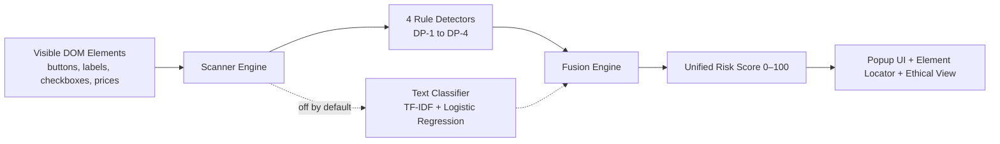

# DarkGuard AI
> Intelligent, privacy-first Chromium extension auditing deceptive e-commerce design patterns on-device.

[](https://github.com/rudrakshsharma1312-gif/Dark-pattern/actions)

---

## 1. What DarkGuard AI Does

DarkGuard AI is a browser extension (Chrome, Brave, Edge) that detects deceptive UI patterns ("dark patterns") on shopping pages, presents verifiable evidence, and neutralizes manipulation in-place:

1. **Detects 4 Core Patterns**:
   - **DP-1 Fake Urgency & Scarcity**: Countdown timers that remain frozen across a 10-second observation window.
   - **DP-2 Misleading Discount Calculations**: Mismatches between reference prices and stated percentage discounts ($>5\%$ discrepancy).
   - **DP-3 Confirm Shaming**: Refusal and opt-out buttons with guilt-inducing phrasing matched against a curated lexicon.
   - **DP-4 Pre-Selected Extras**: Pre-checked insurance, warranty, or donation add-on checkboxes inside purchase containers.
2. **Deterministic Evidence**: Every finding cites demonstrable proof—the frozen timer readings, discount arithmetic, or matched refusal phrase.
3. **0–100 Unified Risk Score**: Categorized into Low (0–24), Moderate (25–49), High (50–74), and Very high (75–100).
4. **Locate Element**: Smoothly scrolls the page and displays an animated pulsing outline over flagged elements.
5. **Ethical View with Show Original**: Injects non-destructive contextual advisory notes and a summary banner without ever altering merchant prices or form controls. Clicking **Show original** guarantees 100% exact pre-audit DOM restoration.

> **Disclaimer**: DarkGuard AI findings are advisory risk signals for shopper awareness, not legal determinations of deceptive intent.

<!-- TODO: Add actual UI screenshots to docs/screenshots/ when captured:
     1. popup-high-risk.png: Extension popup on planted-combined-01.html showing Score 66 (High) & 4 findings cards.
     2. ethical-view-banner.png: Storefront view with Ethical View toggled ON, showing lavender summary banner & in-situ warning notes.
     3. show-original-restored.png: Storefront view immediately after clicking "Show original", demonstrating exact DOM restoration.
     4. popup-clean-zero-score.png: Extension popup on clean-ticking-timer.html or clean-coffee-maker.html showing Score 0 (Low) & 0 findings.
-->

---

## 2. Install the Extension in 2 Minutes

DarkGuard AI runs on any Chromium browser (Google Chrome, Brave, Microsoft Edge). We provide two supported installation paths, both delivering the **identical, single-source verified extension build**:

### Method A: From Website (.zip Download)
1. Download the extension ZIP: [**`darkguard-extension.zip`**](https://rudrakshsharma1312-gif.github.io/Dark-pattern/downloads/darkguard-extension.zip)
2. Extract all contents to a folder on your computer.
3. In Chrome or Brave, navigate to `chrome://extensions` (or `edge://extensions` in Edge).
4. Toggle ON **Developer mode** (top-right corner in Chrome).
5. Click **Load unpacked** (top-left) and select the extracted folder.
6. Pin DarkGuard AI to your browser toolbar!

### Method B: From Clone (30 Seconds — Zero Build Required)
The repository commits the pre-packaged, runtime-ready extension directly in `extension-dist/`. You do **not** need Node.js or npm installed:
1. Clone the repository:
   ```bash
   git clone https://github.com/rudrakshsharma1312-gif/Dark-pattern.git
   ```
2. Open `chrome://extensions` (or `edge://extensions`) and enable **Developer mode**.
3. Click **Load unpacked** and select the **`extension-dist`** directory inside the clone.
   > **⚠️ CRITICAL**: Do **NOT** select the repository root folder. To prevent accidental misconfiguration, the repository root contains no `manifest.json` and will fail with `"Manifest file is missing"`. Always select the `extension-dist/` subfolder.
4. Pin the shield icon to your toolbar!

### Confirming Your Build
Open the DarkGuard AI popup or inspect the extension card in `chrome://extensions`:
- The popup footer displays: `Build 0.3.0 (<content-hash>)`
- The extension card shows version: `0.3.0 (<content-hash>)`
- The build stamp is a deterministic SHA-256 fingerprint computed across all runtime files.

---

## 3. Try It Yourself: 16-Page Test Bed

We supply an offline 16-page e-commerce test suite (9 planted scenarios, 7 clean controls). Open [**`test-site/index.html`**](test-site/index.html) or run `npm run serve:site`:

| Test Scenario | Page Link | Planted Manipulation | Expected Score | Level |
|---|---|---|:---:|:---:|
| **All 4 Patterns** | [`planted-combined-01.html`](test-site/planted-combined-01.html) | Frozen timer, 70% fake discount, shaming button, warranty | **66** | **High** |
| **DP-1 Fake Urgency** | [`planted-urgency-01.html`](test-site/planted-urgency-01.html) | Frozen countdown timer (`00:14:59`) | 27 | Moderate |
| **DP-1 Deadline Timer**| [`planted-urgency-02.html`](test-site/planted-urgency-02.html) | Frozen deadline timer (`02:45:00`) | 27 | Moderate |
| **DP-2 Fake Discount** | [`planted-discount-01.html`](test-site/planted-discount-01.html) | "70% off" ($400 &rarr; $200 is 50%) | 18 | Low |
| **DP-2 Slashed Price** | [`planted-discount-02.html`](test-site/planted-discount-02.html) | "55% off" ($180 &rarr; $126 is 30%) | 18 | Low |
| **DP-3 Confirm Shaming**| [`planted-shaming-01.html`](test-site/planted-shaming-01.html) | *"No thanks, I prefer paying full price"* | 7 | Low |
| **DP-3 Guilt Decline** | [`planted-shaming-02.html`](test-site/planted-shaming-02.html) | *"No, I don't want to save money"* | 7 | Low |
| **DP-4 Pre-checked Extra**| [`planted-extras-01.html`](test-site/planted-extras-01.html) | Pre-ticked $49.99 Accidental Warranty | 14 | Low |
| **DP-4 Hidden Add-on** | [`planted-extras-02.html`](test-site/planted-extras-02.html) | Pre-ticked $29.00 Transit Protection | 14 | Low |
| **Clean Control** | [`clean-coffee-maker.html`](test-site/clean-coffee-maker.html) | Honest pricing, neutral decline | **0** | **Low** |
| **Clean Ticking Timer**| [`clean-ticking-timer.html`](test-site/clean-ticking-timer.html) | Actively ticking timer (never falsely flagged) | **0** | **Low** |

### Test Bed Walkthrough
1. Open [`planted-combined-01.html`](test-site/planted-combined-01.html) in your browser.
2. Click the DarkGuard AI shield icon, then click **Scan this page**.
3. Observe the 10-second observation window while it samples the countdown timer.
4. Review the 4 findings cards and the Unified Risk Score of **66 / 100 (High Risk)**.
5. Click **Locate** on any card to jump to and highlight the element.
6. Toggle **Ethical View** ON to review contextual warning banners and notes.
7. Click **Show original** in the header banner: the DOM is restored 100% byte-for-byte.
8. Open [`clean-ticking-timer.html`](test-site/clean-ticking-timer.html) and scan: verifies **0 findings (Score 0)**.

> **Environment Notes**:
> - **Local `file://` URLs**: Chromium blocks extensions from inspecting local file paths by default. Go to `chrome://extensions` &rarr; Details on DarkGuard AI &rarr; toggle ON **"Allow access to file URLs"**, or use `npm run serve:site`.
> - **Restricted Pages**: Browsers strictly forbid extension content scripts on internal pages (`chrome://*`, `edge://*`, and the Chrome Web Store).

---

## 4. How It Works



1. **Scanner Engine**: Filters rendered DOM candidates ($<200$ chars, visible tags, geometry). Never reads input values or checkout forms.
2. **Temporal Observation & Scan Duration (DP-1)**: When timer digits are detected, DarkGuard samples the text across a deterministic 10-second observation window ($\Delta t \ge 10\text{ s}$). If values do not decrement, it flags a frozen countdown. Real decrementing timers pass without detection. A full scan takes **approximately 11 seconds** because of the 10-second DP-1 observation window; execution time outside of the observation window has not been separately benchmarked in a real browser.
3. **Risk Formula & Category Weights**:
   $$\text{Risk Score} = \min\left(100, \sum_{i=1}^{4} w_i \times \text{Severity}_i \times \text{Confidence}_i \times 33.3\right)$$
   | Category | Weight ($w_i$) | Rationale |
   |---|:---:|---|
   | **DP-1 Fake Urgency** | **0.30** | High psychological coercion; Fabricated deadline pressure |
   | **DP-2 Misleading Discount** | **0.30** | Direct financial impact; Arithmetic contradiction |
   | **DP-3 Confirm Shaming** | **0.25** | Manipulative dark pattern; Emotional degradation |
   | **DP-4 Pre-Selected Extras** | **0.15** | Basket inflation; Opt-out default checkbox |

   *Worked Example (`planted-combined-01.html`)*: DP-1 ($0.30 \times 1.0$), DP-2 ($0.30 \times 1.0$), DP-3 ($0.25 \times 0.90$), and DP-4 ($0.15 \times 1.0$) combine into a raw score of **66 / 100 (High Risk)**.
4. **Ethical View Guarantees**:
   - Never modifies merchant price text or numbers.
   - Never disables, intercepts, or alters form submissions.
   - Never modifies or unchecks form controls without user action.
   - "Show original" removes injected nodes and restores exact pre-audit DOM state.

---

## 5. Honest Status & Results

### ML Architecture & Release Gate Disclosure (ML-R9)
DarkGuard AI was architected with a hybrid engine: deterministic DOM rules and an on-device text classifier (`src/ml/classifier.ts`, weight array loaded from `src/ml/shaming-v1.json`). The text model is **TF-IDF (sublinear word unigrams and adjacent word bigrams; 2,521 fitted features, max 4,000) + one-vs-rest logistic regression running in plain JavaScript**. It is **not TensorFlow.js** and requires no external ML runtimes or GPU acceleration.

#### Release Gate Outcome (ML-R9)
Evaluated across 30 labeled fixture pages (20 planted, 10 clean controls) per [`ml/model-card-v1.md`](ml/model-card-v1.md):
- **Macro Precision on Pages**: **0.914** (criterion $\ge 0.85$ &rarr; **PASS**)
- **Macro Recall on Pages**: **0.804** (Micro Recall: **0.810**, 34 of 42 planted instances caught; criterion $\ge 0.70$ &rarr; **PASS**)
- **Clean-Page False Alarm Check**: **FAILED** (0 of 10 clean pages flagged with rules only vs. 3 of 10 clean pages flagged with rules + ML; criterion was zero increase in false-positive rate over rules-only)
- **Gate Outcome**: **FAILED** (shipped with `ml_enabled: false` by default; the extension operates in verified rules-only mode)

Complete evaluation reports and metrics: [`ml/model-card-v1.md`](ml/model-card-v1.md), [`eval/reports/ablation.md`](eval/reports/ablation.md), and [`eval/reports/eval-results.json`](eval/reports/eval-results.json). Technical reconciliation notes between evaluation artifacts are documented in [`docs/EVAL_NOTES.md`](docs/EVAL_NOTES.md).

### Curated Test Bed Evaluation
Results on our curated test bed (23 pages: 16 test-site scenarios in [`test-site/`](test-site/) + 7 real-world clean fixtures in [`tests/fixtures/real-world-clean/`](tests/fixtures/real-world-clean/); evaluated via `npm run eval:real` in rules-only mode):
- **Planted Target Patterns Caught on Curated Test Bed**: 12 of 12 (detectors were tuned on these scenarios)
- **Clean Pages with False Flags**: 0 of 14 (0.0% false alarm rate on these clean controls)
- **Important Limitation**: These metrics reflect performance on our curated test bed only; real-world accuracy on uncurated web stores has not been measured.

### Known Limitations
1. **Dynamic / Late-Loading Prices**: Single-page stores that dynamically render price calculations after scan completion require a rescan.
2. **Multi-Step Checkout Add-ons**: Extras injected exclusively on subsequent payment screens are not visible on initial product pages.
3. **Text-Only Scarcity**: Claims such as *"Only 2 items left"* without a timer are difficult to verify without server inventory access.
4. **Language Scope**: Curated lexicons and detectors currently cover English e-commerce pages ($Rs, \$, \text{EUR}$).

---

## 6. Privacy & Security Architecture

- **Zero Network Calls**: The extension bundle contains zero `fetch()`, `XMLHttpRequest`, `WebSocket`, or `sendBeacon()` calls (enforced by automated test [`tests/zero-network.test.ts`](tests/zero-network.test.ts)).
- **No Cloud Backend**: All heuristics and scoring run 100% in-browser. Zero analytics, accounts, or tracking pixels.
- **Form Input Privacy**: Content scripts strictly ignore `input[type="password"]`, `input[type="email"]`, credit card fields, and CVV inputs ([`tests/scanner-privacy.test.ts`](tests/scanner-privacy.test.ts)).
- **Local History**: Scan history is retained strictly on-device in `chrome.storage.local` (maximum 20 entries; records domain, path, timestamp, and score; zero page contents stored).
- **Model Integrity Protection**: Shipped model weights are validated via pure-JS SHA-256 (`e1f81a1e...`). Corrupted models fail safely to rules-only mode without crashing.

---

## 7. Web App & Public Surfaces

DarkGuard AI provides three operational surfaces:

1. **Browser Extension (`extension-dist/`)**: The real Manifest V3 extension.
2. **React Web Simulator (`src/`, `dist-web/`)**: Interactive in-browser testing environment and evaluation platform. Served locally via `npm run dev` at `http://localhost:3000`. Clearly labeled as an educational simulator, not the browser extension.
3. **Landing Page & Test Bed (`landing/`, `test-site/`)**: Comprehensive guide and 16-page evaluation suite.

### Hosted Production URLs
- **Landing Page**: [https://rudrakshsharma1312-gif.github.io/Dark-pattern/](https://rudrakshsharma1312-gif.github.io/Dark-pattern/)
- **Web App & Simulator**: [https://rudrakshsharma1312-gif.github.io/Dark-pattern/app/](https://rudrakshsharma1312-gif.github.io/Dark-pattern/app/)
- **16-Page Test Bed**: [https://rudrakshsharma1312-gif.github.io/Dark-pattern/test-site/](https://rudrakshsharma1312-gif.github.io/Dark-pattern/test-site/)
- **Extension ZIP**: [https://rudrakshsharma1312-gif.github.io/Dark-pattern/downloads/darkguard-extension.zip](https://rudrakshsharma1312-gif.github.io/Dark-pattern/downloads/darkguard-extension.zip)

---

## 8. Developer Guide

### Prerequisites
- Node.js 18+ (tested on Node 20.x)
- npm 9+

### Available Scripts
```bash
npm install                 # Install dependencies
npm test                    # Run all 8 Vitest suites (80 unit & invariant tests)
npm run verify:pages        # Run end-to-end verification across all 16 test-site pages
npm run eval:real           # Evaluate real engine performance on test bed (n=23)
npm run build:extension     # Compile src/content/scanner-entry.ts to content/scanner.js
npm run package:extension   # Build extension-dist/ and downloads/darkguard-extension.zip
npm run verify:extension    # Cryptographically verify extension-dist against fresh build
npm run release:extension   # Rebuild and stage extension-dist/ for git commit
npm run build:web           # Build React web application into dist-web/
npm run verify:links        # Crawl internal links & verify served zip byte parity
npm run dev                 # Launch local development server (React app on :3000)
npm run serve:site          # Serve test site & landing page under /Dark-pattern/ on :8080
```

> **Developer Rule**: Whenever modifying files in `popup/` or `content/`, run `npm run release:extension` and commit `extension-dist/`. Our CI workflow enforces that `extension-dist/` matches source code bit-for-bit.

### Repository Layout
```
Dark-pattern/
├── src/
│   ├── manifest.json       # Source extension manifest (v0.3.0)
│   ├── engine/             # Detection orchestrator, rules DP-1..4, fusion, ethical-view
│   ├── ml/                 # TF-IDF feature extractor, classifier, checksums
│   ├── eval/               # Benchmark labels and evaluation runner
│   └── components/         # React simulator, evaluation dashboard, test shop
├── extension-dist/         # Single-source runtime extension (load unpacked here)
│   ├── manifest.json       # Stamped runtime manifest with deterministic content hash
│   ├── background/         # Service worker (MV3 activeTab injector)
│   ├── popup/              # Vanilla MV3 popup (HTML, CSS, JS with build stamp)
│   └── content/            # Bundled scanner.js, highlighter, ethical-view, models
├── downloads/              # Packaged archives (darkguard-extension.zip, build-info.txt)
├── landing/                # Public marketing landing page & quick start
├── test-site/              # 16-page deterministic dark pattern test bed
├── scripts/                # Packaging, bundling, link crawler, and verifiers
├── tests/                  # Vitest suites (detectors, privacy, contracts, zero-network)
└── .github/workflows/      # GitHub Pages (deploy) and CI (verification) workflows
```

---

## 9. Troubleshooting & FAQ

| Problem | Cause | Solution |
|---|---|---|
| **"Manifest file is missing or unreadable"** | Selected wrong folder in `Load unpacked` | Select `extension-dist/` (or the unzipped folder), **not** the repository root. |
| **Developer mode disabled** | Browser security restriction | Toggle ON **Developer mode** in top-right of `chrome://extensions`. |
| **10-second wait during scan** | Expected temporal observation | DarkGuard samples timers over 10 seconds to differentiate frozen vs real timers. |
| **Scan inactive on `file://` pages** | Chromium security boundary | Go to `chrome://extensions` &rarr; Details on DarkGuard AI &rarr; toggle ON **"Allow access to file URLs"**. |
| **"Cannot scan this page"** | Restricted Chromium URL | Extensions cannot run on `chrome://*`, `edge://*`, or the Web Store. Test on HTTP/HTTPS or `test-site/`. |
| **Stale popup or outdated UI** | Browser cached extension assets | Click the circular **↺ (Reload)** button on DarkGuard AI in `chrome://extensions`, then close and reopen the popup. |

---

## 10. Recommended 3-Minute Demo Walkthrough

*(See [`docs/DEMO_CHECKLIST.md`](docs/DEMO_CHECKLIST.md) for complete rehearsal steps)*

1. **Step 1 (0:00–1:00) — Combined Audit**:
   - Open [`test-site/planted-combined-01.html`](test-site/planted-combined-01.html).
   - Click **Scan this page**.
   - Explain the 10-second observation window verifying that the timer is frozen at `00:14:59`.
   - Point out the **Unified Risk Score of 66 / 100 (High Risk)** and all 4 detected cards.
2. **Step 2 (1:00–1:45) — In-Page Proof & Ethical View**:
   - Click **Locate** on a finding to demonstrate smooth scrolling and pulsating highlight box.
   - Toggle **Ethical View** ON: demonstrate lavender summary banner and warning annotations.
   - Click **Show original**: demonstrate 100% exact DOM restoration with zero lingering nodes.
3. **Step 3 (1:45–2:30) — Clean Control Verification**:
   - Open [`clean-ticking-timer.html`](test-site/clean-ticking-timer.html) or [`clean-coffee-maker.html`](test-site/clean-coffee-maker.html).
   - Run scan. DarkGuard reports **0 findings (Score 0 / 100, Low Risk)**. Actively ticking timers are never falsely flagged.
4. **Step 4 (2:30–3:00) — Engineering Honesty**:
   - Open the web app at `http://localhost:3000` or `/app/`.
   - Show the **Evaluation & Ablation Platform**: transparently explain that the text model failed the release gate due to false alarms on clean controls, so rules-only was selected for release.

### Live Demo Fallback Table
| If this happens... | Do this instead |
|---|---|
| Extension fails to load in Chrome | Open the web simulator at `http://localhost:3000` or `/app/`. |
| Countdown timer is flaky on external site | Use deterministic scenario [`test-site/planted-urgency-01.html`](test-site/planted-urgency-01.html). |
| Real storefront blocks extension / anti-bot | Run the 16-page deterministic local test bed (`test-site/index.html`). |

---

## 11. Roadmap, Team & Credits

### Future Roadmap
- Stronger DP-2 and DP-4 heuristic extraction for dynamic SPAs.
- Retrain text classifier with numeric entity masking and multi-annotator review before re-evaluating release gate ML-R9.
- Broaden currency and multi-language support (currently English with $Rs, \$, \text{EUR}$).
- Complete roadmap items tracked in [`LATER.md`](LATER.md).

### Team Credits
- **Rudraksh Sharma** (`rudrakshsharma1312-gif`)
- **Aditri Singh** (`Aditri-web`)
- **Gurleen Kaur Bhatia** (`Gurleen`)

### License & Third-Party Notice
<!-- TODO: Choose and add an open-source or proprietary LICENSE file to the repository root (e.g. MIT, Apache-2.0, or All Rights Reserved). -->
- **License**: No `LICENSE` file is currently present in the repository root; all rights are reserved by the authors until an official open-source license is chosen.
- **Third-Party Libraries**: Built using open-source packages: React & Vite (MIT), esbuild (MIT), Tailwind CSS (MIT), Lucide React (ISC), Vitest (MIT), Playwright (Apache 2.0), and Python scientific libraries (scikit-learn, numpy, pandas under BSD).
<!-- TODO: Team to confirm and document how the training strings were originally generated (e.g. written by hand, harvested from audits, or AI-assisted). -->
- **Training Data**: The experimental text model was trained on 823 short UI strings created for this project across 10 simulated merchant sites, labeled per [`ml/labeling.md`](ml/labeling.md) by a single annotator (Member B). No external or public dataset was used.
