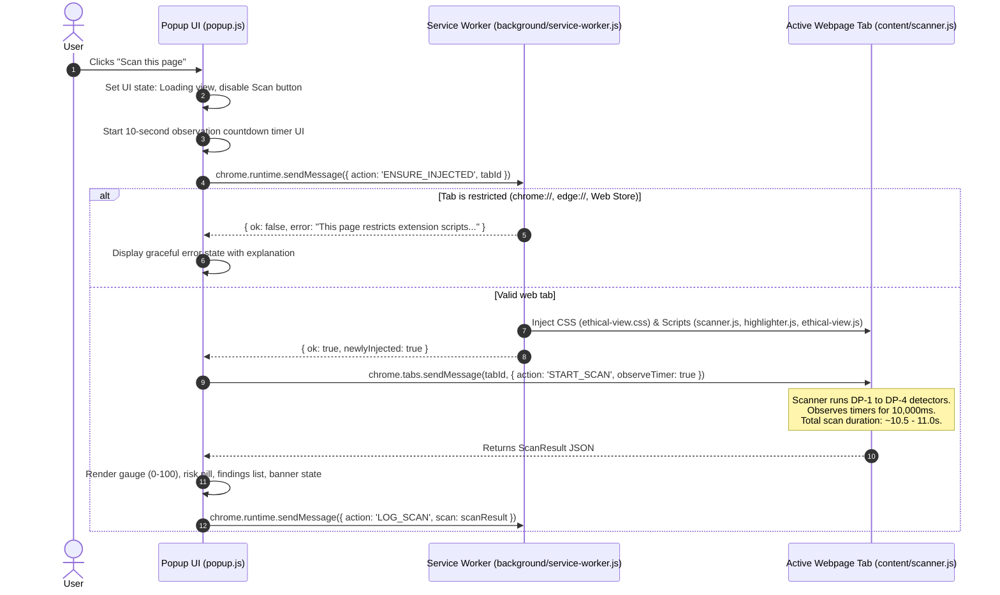

# DarkGuard AI — Extension Popup & Content Script Contract

> **Target Audience**: Member C (Popup & UI Engineer)  
> **Status**: Frozen / Mandatory Implementation Contract  
> **Scope**: Communication protocol between Extension Popup (`popup/`), Background Service Worker (`background/service-worker.js`), and Injected Content Scripts (`content/scanner.js`, `content/highlighter.js`, `content/ethical-view.js`).

---

## 1. End-to-End Scan Flow

To comply with Chrome Web Store safety guidelines and Manifest V3 security requirements, DarkGuard AI **does not use static `<all_urls>` content scripts**. Content scripts are injected dynamically on-demand only when the user clicks the extension popup.

### Sequence of Operations:



### What the Popup UI Must Display During Scan:
- **Duration**: `START_SCAN` takes **approximately 11 seconds** because DP-1 Fake Urgency performs a mandatory 10-second temporal observation window to verify whether timer digits actually tick or stay frozen.
- **Loading State UI**:
  - Disable the "Scan this page" button.
  - Show a synchronized 10-second countdown (e.g. `10s`, `9s`, ..., `1s`).
  - Display progress copy: `"Verifying Countdown Evidence..."` and `"Observing timer to verify if digits update or stay frozen..."`.
  - When the countdown reaches `0s`, display `"Evaluating phrasing and calculating risk score..."` while awaiting the final response payload.

---

## 2. Complete Message Passing Contract

All extension messaging uses standard `chrome.runtime.sendMessage` and `chrome.tabs.sendMessage`.

### 2.1 `ENSURE_INJECTED` (Popup $\rightarrow$ Background Service Worker)
Ensures stylesheets and content scripts are active in the target tab before dispatching commands.

- **Recipient**: Background Service Worker (`chrome.runtime.sendMessage`)
- **Request Payload**:
  ```json
  {
    "action": "ENSURE_INJECTED",
    "tabId": 123456789
  }
  ```
- **Success Response**:
  ```json
  {
    "ok": true,
    "newlyInjected": true
  }
  ```
  *(Or `{ "ok": true, "alreadyInjected": true }` if already loaded).*
- **Failure / Restricted Page Response**:
  ```json
  {
    "ok": false,
    "error": "This page restricts extension scripts (e.g., chrome://, edge://, or Web Store pages). Please scan on an HTTP, HTTPS, or local test-site page."
  }
  ```

---

### 2.2 `START_SCAN` (Popup $\rightarrow$ Content Script in Active Tab)
Triggers DOM candidate extraction, temporal timer observation (10s), rule detectors, and risk scoring.

- **Recipient**: Active Tab (`chrome.tabs.sendMessage(tabId, ...)`)
- **Request Payload**:
  ```json
  {
    "action": "START_SCAN",
    "observeTimer": true
  }
  ```
- **Success Response**: Full `ScanResult` object (see Section 3).
- **Error Response**:
  ```json
  {
    "error": "Scanner failed to evaluate page candidates."
  }
  ```

---

### 2.3 `GET_ETHICAL_VIEW_STATUS` (Popup $\rightarrow$ Content Script in Active Tab)
Checks whether the Ethical View overlay is currently enabled on the tab.

- **Recipient**: Active Tab (`chrome.tabs.sendMessage(tabId, ...)`)
- **Request Payload**:
  ```json
  {
    "action": "GET_ETHICAL_VIEW_STATUS"
  }
  ```
- **Response**:
  ```json
  {
    "state": "ON"
  }
  ```
  *(Or `{ "state": "OFF" }`).*

---

### 2.4 `TOGGLE_ETHICAL_VIEW` (Popup $\rightarrow$ Content Script in Active Tab)
Enables or disables the non-destructive Ethical View banner and contextual note callouts.

- **Recipient**: Active Tab (`chrome.tabs.sendMessage(tabId, ...)`)
- **Request Payload**:
  ```json
  {
    "action": "TOGGLE_ETHICAL_VIEW",
    "enabled": true,
    "detections": [ /* Array of Detection objects from currentScanResult */ ],
    "riskScore": 66,
    "level": "High"
  }
  ```
- **Response**:
  ```json
  {
    "status": "applied",
    "state": "ON"
  }
  ```
  *(Or `{ "status": "restored", "state": "OFF" }` when `enabled: false`).*

---

### 2.5 `HIGHLIGHT_ELEMENT` (Popup $\rightarrow$ Content Script in Active Tab)
Scrolls the webpage smoothly to the suspicious element and activates an animated pulse outline.

- **Recipient**: Active Tab (`chrome.tabs.sendMessage(tabId, ...)`)
- **Request Payload**:
  ```json
  {
    "action": "HIGHLIGHT_ELEMENT",
    "candidateRef": "dg-4",
    "selector": "div.timer-container > span#countdown-val",
    "label": "Fake Urgency & Scarcity"
  }
  ```
- **Response**:
  ```json
  {
    "success": true
  }
  ```

---

### 2.6 `LOG_SCAN` (Popup $\rightarrow$ Background Service Worker)
Persists the scan summary to `chrome.storage.local` (capped at the 20 most recent scans).

- **Recipient**: Background Service Worker (`chrome.runtime.sendMessage`)
- **Request Payload**:
  ```json
  {
    "action": "LOG_SCAN",
    "scan": { /* The complete ScanResult object */ }
  }
  ```
- **Response**:
  ```json
  {
    "status": "saved",
    "count": 5
  }
  ```

---

### 2.7 `GET_HISTORY` (Popup $\rightarrow$ Background Service Worker)
Retrieves recent scan logs for popup history views.

- **Recipient**: Background Service Worker (`chrome.runtime.sendMessage`)
- **Request Payload**:
  ```json
  {
    "action": "GET_HISTORY"
  }
  ```
- **Response**:
  ```json
  {
    "scans": [
      {
        "id": "scan-1741950000000",
        "domain": "novastore.local",
        "url_path": "/planted-combined-01.html",
        "timestamp": "2026-11-14T08:00:00.000Z",
        "risk_score": 66,
        "level": "High",
        "model_version": "darkguard-text-v1",
        "findingsCount": 4,
        "ml_enabled": false
      }
    ]
  }
  ```

---

### 2.8 `CLEAR_HISTORY` (Popup $\rightarrow$ Background Service Worker)
Clears all persisted scan records from local storage.

- **Recipient**: Background Service Worker (`chrome.runtime.sendMessage`)
- **Request Payload**:
  ```json
  {
    "action": "CLEAR_HISTORY"
  }
  ```
- **Response**:
  ```json
  {
    "status": "cleared"
  }
  ```

---

## 3. Data Schema: `ScanResult` and `Detection`

### 3.1 `ScanResult` Schema

| Field | Type | Required? | Description |
|---|---|:---:|---|
| `id` | `string` | **Yes** | Unique scan identifier (e.g. `scan-1741950000000`) |
| `domain` | `string` | **Yes** | Hostname of the scanned page (e.g. `localhost` or `store.example.com`) |
| `url_path` | `string` | **Yes** | Pathname of the scanned page (e.g. `/planted-combined-01.html`) |
| `timestamp` | `string` | **Yes** | ISO-8601 creation timestamp |
| `risk_score` | `number` | **Yes** | Integer from `0` to `100` |
| `level` | `string` | **Yes** | Risk level string: `'Low'`, `'Moderate'`, `'High'`, or `'Very high'` |
| `model_version` | `string` | **Yes** | Text model version identifier (`"darkguard-text-v1"`) |
| `ml_enabled` | `boolean` | **Yes** | `false` in production per Release Gate decision |
| `classifierChecksumValid`| `boolean` | **Yes** | `true` if model passed SHA-256 validation; `false` if tampered/corrupted |
| `detections` | `Detection[]` | **Yes** | Array of detected dark pattern findings |
| `rawCandidatesCount` | `number` | **Yes** | Total visible interactive elements inspected (e.g. `48`) |
| `scanDurationMs` | `number` | **Yes** | Execution time in milliseconds (excluding timer observation wait) |
| `coverage` | `object` | *Optional*| Candidate coverage metadata `{ checked, total, details }` |

### 3.2 `Detection` Schema

| Field | Type | Required? | Description |
|---|---|:---:|---|
| `id` | `string` | **Yes** | Unique detection ID (e.g. `det-DP-1-dg-4-mwg5e169`) |
| `category` | `string` | **Yes** | Internal category code: `'fake_urgency'`, `'misleading_discount'`, `'confirm_shaming'`, `'preselected_extra'` |
| `categoryId` | `string` | **Yes** | Pattern code: `'DP-1'`, `'DP-2'`, `'DP-3'`, or `'DP-4'` |
| `categoryName` | `string` | **Yes** | Human-readable title (e.g. `"Fake Urgency & Scarcity"`) |
| `candidateRef` | `string` | **Yes** | DOM element reference key (e.g. `"dg-4"`) matching `data-dg-ref` |
| `severity` | `number` | **Yes** | Severity integer: `1` (Minor), `2` (Moderate), `3` (Major) |
| `confidence` | `number` | **Yes** | Float between `0.0` and `1.0` (e.g. `0.9`) |
| `source` | `string` | **Yes** | Detection source: `'rule'`, `'ml'`, or `'rule+ml'` |
| `explanation` | `string` | **Yes** | Factual observation sentence explaining the finding |
| `aiExplanation` | `string` | *Optional*| Extended contextual explanation |
| `templateId` | `string` | **Yes** | Ethical View intervention template (e.g. `'ET-URG-01'`, `'ET-DISC-01'`, `'ET-CONF-01'`, `'ET-EXTRA-01'`) |
| `evidenceSnippet` | `string` | **Yes** | The exact text snippet extracted from the element (up to 200 chars) |
| `elementSelector` | `string` | **Yes** | CSS selector used to locate the element |
| `elementRect` | `object` | *Optional*| Position and dimensions `{ x, y, w, h }` |
| `details` | `object` | **Yes** | Structured mathematical and observation evidence (see below) |
| `sellerQuestion` | `string` | *Optional*| Suggested clarifying question for the shopper to ask customer support |
| `isUncertain` | `boolean` | *Optional*| `true` if this detection came from an uncertain signal |

#### `details` Object Contents by Category:
- **DP-1 (Fake Urgency)**: `{ observedSeconds: 10, initialValue: "00:14:59", finalValue: "00:14:59" }`
- **DP-2 (Misleading Discount)**: `{ currentPrice: 200, referencePrice: 400, statedPercent: 70, calculatedPercent: 50, currencySymbol: "$" }`
- **DP-3 (Confirm Shaming)**: `{ matchedPhrase: "no thanks, i prefer paying full price" }`
- **DP-4 (Pre-selected Extras)**: `{ addonLabel: "Add 3-Year Extended Warranty & Protection Plan" }`

---

## 4. Banner Rules & Model States

The popup header displays an informational banner under specific conditions:

| `ml_enabled` | `classifierChecksumValid` | Banner Visible? | Banner Title | Banner Description |
|:---:|:---:|:---:|---|---|
| `false` | `true` | **YES** | `Text model off (Release Gate)` | `"Text model is off because it did not pass the release gate. Running rules-only scan."` |
| `false` | `false` | **YES** | `Text model unavailable` | `"Model checksum verification failed. Running rules-only scan."` |
| `true` | `false` | **YES** | `Text model unavailable` | `"Model checksum verification failed. Running rules-only scan."` |
| `true` | `true` | **NO** | *(Hidden)* | *(Full hybrid rule + ML scanning active)* |

> **Production Default**: DarkGuard AI currently ships with `ml_enabled: false` and `classifierChecksumValid: true`. The popup MUST show the `"Text model off (Release Gate)"` banner by default.

---

## 5. Risk Score Bands & Interpretations

Risk scores range from `0` to `100`:

| Score Range | Risk Level | Severity Color | UI Meaning |
|:---:|:---:|:---:|---|
| **0 – 24** | **Low** | Mint (`#8FD1B0`) | Design elements look transparent and sound. |
| **25 – 49** | **Moderate** | Butter (`#EBD27A`) | A few design signals worth double-checking before checkout. |
| **50 – 74** | **High** | Peach (`#F1A98F`) | Multiple urgency, discount, or extra cost discrepancies found. |
| **75 – 100** | **Very high**| Rose (`#E8A0B5`) | Significant deceptive patterns detected on page. |

### Cardinal Legal & Ethical Rule:
Findings are **design signals**, never legal or regulatory conclusions. Copy displayed in the popup must never accuse the merchant of fraud or illegality (e.g. use *"Calculated discount discrepancy observed"* rather than *"Merchant is committing illegal price fraud"*).

---

## 6. Strict Privacy & Safety Invariants

The popup and extension must adhere to these three non-negotiable rules:
1. **Never mutate webpage content directly from popup script**: All DOM manipulations (highlighting, note insertion, "Show original" restoration) must be delegated to `content/highlighter.js` and `content/ethical-view.js`.
2. **Never read sensitive form inputs**: The engine explicitly excludes password fields, credit card inputs, CVVs, and address fields. The popup must never request or display user input values.
3. **Zero Network Calls**: All rule evaluation, text classification, and risk scoring runs **100% on-device in client memory**. The popup must never send DOM trees, URLs, or findings to external analytics or cloud servers.

---

## 7. Checklist: Features in `popup.js` / `popup.html` That Must Survive Redesign

When Member C replaces `popup/popup.html` and `popup/popup.js` with the new design from AI Studio, the following logic **must remain intact**:

- [x] **Service Worker Dynamic Injection**: Calling `ENSURE_INJECTED` via `chrome.runtime.sendMessage` before attempting `START_SCAN`.
- [x] **Restricted URL Handling**: Displaying a friendly error when scanning on `chrome://`, `edge://`, or Web Store pages.
- [x] **10-Second Timer Countdown**: Providing user visual feedback during the 10-second temporal observation window.
- [x] **Two Banner States**: Properly toggling between `"Text model off (Release Gate)"` and `"Text model unavailable"`.
- [x] **Scan History Logging**: Calling `LOG_SCAN` via `chrome.runtime.sendMessage` upon successful scan completion.
- [x] **Message Actions**: Retaining exact string names: `START_SCAN`, `GET_ETHICAL_VIEW_STATUS`, `TOGGLE_ETHICAL_VIEW`, `HIGHLIGHT_ELEMENT`, `LOG_SCAN`, `GET_HISTORY`, `CLEAR_HISTORY`.
- [x] **Show Original Sync**: Listening to `ETHICAL_VIEW_STATUS_CHANGED` runtime messages so the Ethical View toggle switch in the popup updates when the user clicks "Show original" in the webpage banner.
- [x] **Standalone Offline Demo Mode**: Retaining the offline sample fallback (`loadSampleDemoResult()`) when opened outside an extension tab context.
